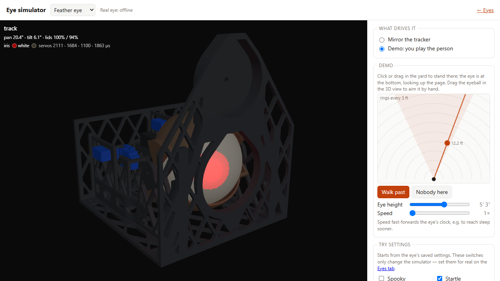

# Spooky Eye Tracker

[](https://github.com/coreyfournier/SpookyEyeTracker/actions/workflows/ci.yml)

A 3D-printed animatronic eye hangs in your front window and watches people walk by. Up to
two security cameras see the yard. A tracker running on a PC finds people, works out where
each one is standing and how tall they are, and tells each eye where to look. The eye
follows them, blinks, glances around when nobody's there, and glows in colours that change
with its mood. A Halloween mode adds flicker and a jump-scare.

<p align="center">
  
  
</p>
<p align="center"><i>The eye from the street, through the window glass (left), and from the side: the frame hangs
flat on the inside of the glass from one suction cup (right).</i></p>

## How it works

```
 0-2 cameras ─RTSP─► CameraWorker (YOLO pose + ByteTrack, per camera)
                        │ box + face keypoints → ground position + eye-level height
                        ▼
                    World (fuses the cameras into "people"; triangulates faces both cameras see)
                        ▼
                    Director (picks a person per eye: closest / spread)
                        │ pan/tilt per eye, 20 Hz UDP
                        ▼
                    ESP32 eye(s) - smoothing, blink, wander, iris colour, spooky mode
```

The system has three parts, and each has its own guide:

| Part | What it is | Guide |
|------|------------|-------|
| **Tracker** (PC) | Python service with a web UI. Reads the cameras, runs YOLO person detection (GPU or CPU), places people on a yard map, picks a target for each eye and streams angles to the eyes. Runs in Docker or directly on Windows. Calibrated from your phone. Includes a 3D eye simulator. | [docs/TRACKER.md](docs/TRACKER.md) |
| **Eye controller** (ESP32) | PlatformIO firmware for each eye. Drives four servos (pan, tilt, two eyelids) and a 7-LED ring, runs the behaviours on its own, and takes its settings and firmware updates over WiFi. | [docs/FIRMWARE.md](docs/FIRMWARE.md), [docs/WIRING.md](docs/WIRING.md) |
| **Printed eye and mount** | A 102 mm glowing eyeball in a two-axis gimbal with moving lids, held in a lattice frame that hangs on the window from a suction cup. Generated from a Python CAD script. | [docs/PRINTED_PARTS.md](docs/PRINTED_PARTS.md) |

Detection knows nothing about eyes, and eyes know nothing about cameras. To add an eye,
flash another board and add an entry for it in the tracker's config (or the UI).


<p align="center"><i>The live yard map on Halloween night: both cameras' fields of view (blue), the eye in the
front window (orange) and the line it's looking along, and everyone the cameras see, with
their position and eye height.</i></p>

This is a real capture, taken before the cameras were calibrated, and it shows why
calibration matters. The two cameras disagree about where one person is standing, so
they appear as two people (#1 and #3) about 3 m apart, and one camera puts their eyes
2.04 m off the ground. The phone [camera calibration wizard](docs/TRACKER.md#cameras-do-this-first)
fixes this by walking you around the yard: afterwards both cameras place you in the same
spot, and they measure your height correctly.


The tracker's web UI shows each camera with the people it found, the yard map, and a
settings card for every eye and camera. There are also phone pages for calibrating the
cameras and the eyes' aim while you stand in the yard. Take the full tour in
[docs/TRACKER.md](docs/TRACKER.md#the-web-ui).



The UI also has an [eye simulator](docs/TRACKER.md#eye-simulator): the printed parts in 3D,
running a copy of the firmware's behaviour code. It moves and lights the way the eye would:
tracking, blinking, wandering, startling, then falling asleep. It can mirror what the
tracker sends a real eye, or let you play the person by placing yourself on a yard map.
Settings show in it as you edit them, before you save. You can turn the model, hide parts
and cut it in half to see inside. It works with no eye, camera or printer, so you can try
the project before building anything.

## What you need

- **Per eye:** an ESP32 board (HiLetgo OLED kit or Adafruit HUZZAH32 Feather), a WS2812B
  7-LED jewel, four SG90 servos, a 5 V 3 A supply, a large threaded suction cup, a few
  M2/M3 screws and pins, and about 600 g of PLA. Full lists:
  [electronics](docs/FIRMWARE.md#shopping-list), [hardware and filament](docs/PRINTED_PARTS.md#shopping-list).
- **Once:** 1-2 cameras: Hikvision, any ONVIF IP camera, any RTSP stream, or a USB webcam;
  and a PC or server to run the tracker.
  An NVIDIA GPU detects at full camera frame rate; CPU-only works, but slower.

## Getting started

1. **Optional: try it first.** Run the tracker (step 5) and open **Eye simulator** to see
   the eye and tune its behaviour before printing anything. See
   [Tracker → eye simulator](docs/TRACKER.md#eye-simulator).
2. **Print and assemble an eye.** See [Printed parts](docs/PRINTED_PARTS.md).
3. **Wire it up.** See [Wiring](docs/WIRING.md).
4. **Flash the ESP32** over USB once; after that, updates go over WiFi. See
   [Firmware](docs/FIRMWARE.md#build-and-flash).
5. **Run the tracker** in Docker or on Windows, and point it at your cameras and eyes. See
   [Tracker](docs/TRACKER.md#configure).
6. **Set up the servos** from the web UI. See [Tracker → servo mechanics](docs/TRACKER.md#servo-mechanics-once-per-build).
7. **Calibrate from your phone:** first the cameras (a guided walk around the yard), then
   each eye's aim. See [Tracker → calibration](docs/TRACKER.md#calibration).
8. **Hang it in the window.** See [Printed parts → window mount](docs/PRINTED_PARTS.md#window-mount).

## Repository layout

| Path | What |
|------|------|
| `tracker/` | Python tracker and web UI; `config.default.yaml` is the config template; `tests/` has the unit tests; `eyetracker/static/sim/` is the simulator's port of the firmware behaviour |
| `tracker-data/` | Your live `config.yaml` and calibration data (git-ignored, created on first run) |
| `firmware/` | PlatformIO project; one environment per eye (`eye1` = HiLetgo OLED kit, `eye2` = Adafruit HUZZAH32 Feather) |
| `cad/` | `build.py` generates the printable parts into `cad/stl/`; `export_sim.py` exports the assembly for the simulator; `render.py` draws the pictures in these docs |
| `docs/` | The guides linked above, plus images |
| `Dockerfile`, `docker-compose*.yml` | Container image for the tracker |
| `.github/workflows/ci.yml` | Tests, firmware compile, Docker build and push |
