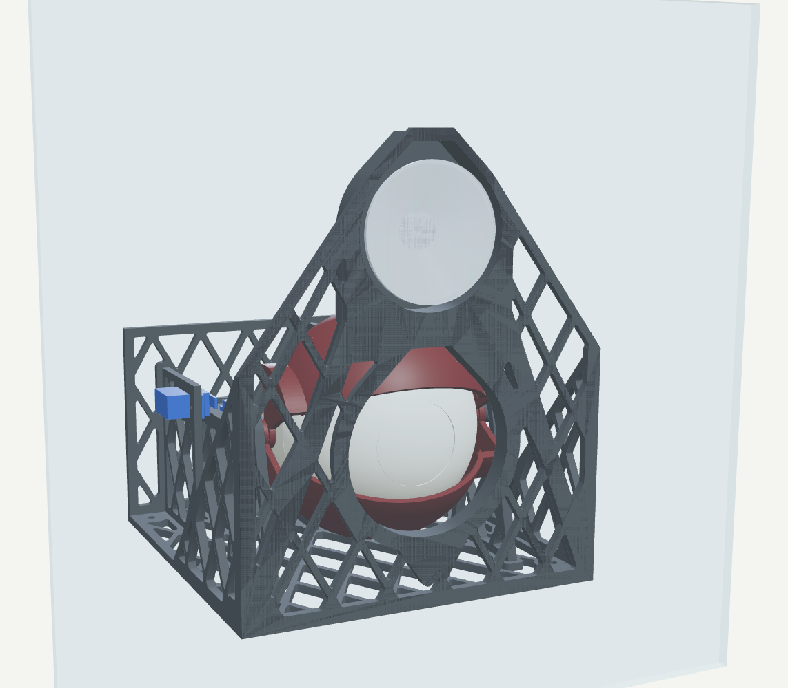
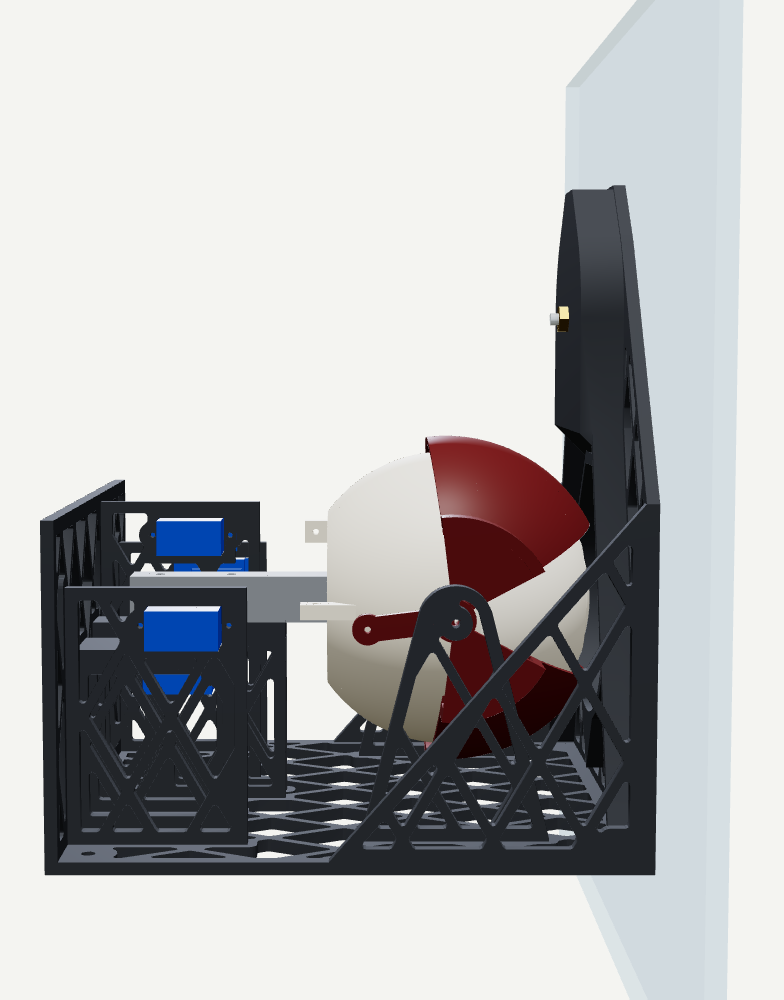
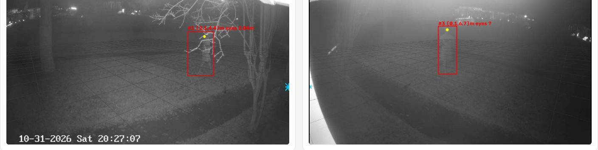
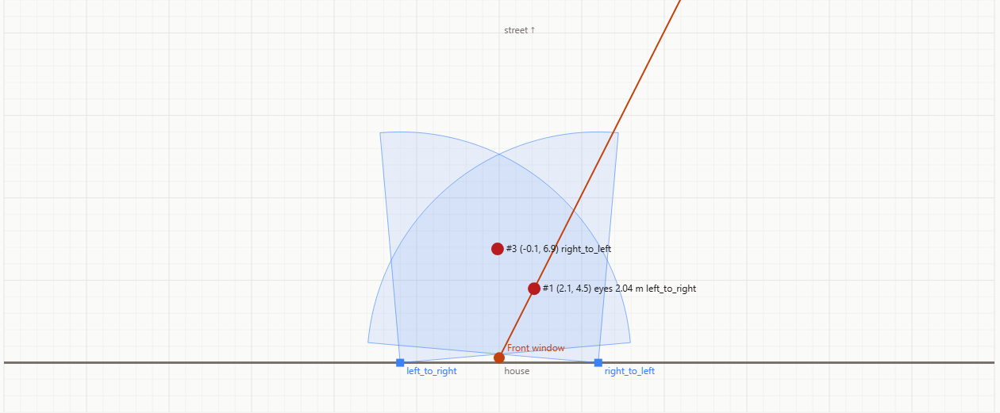
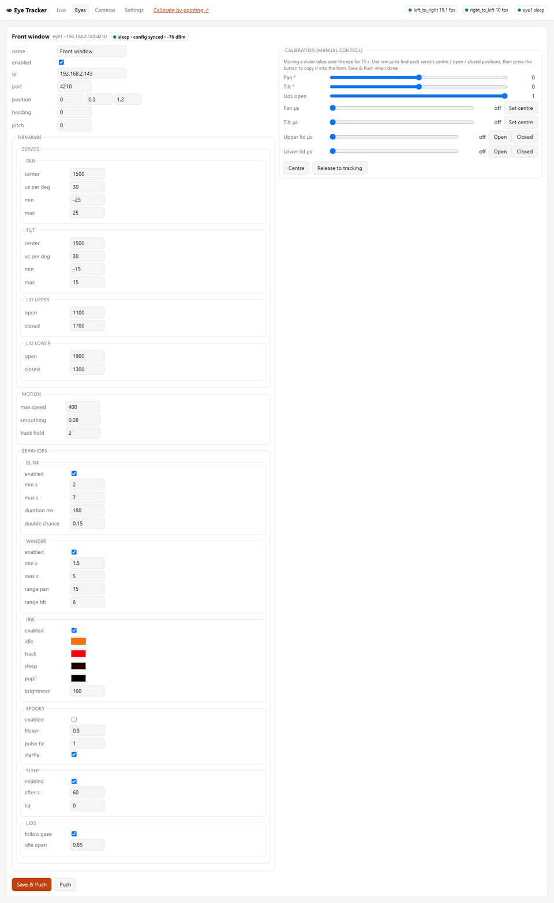
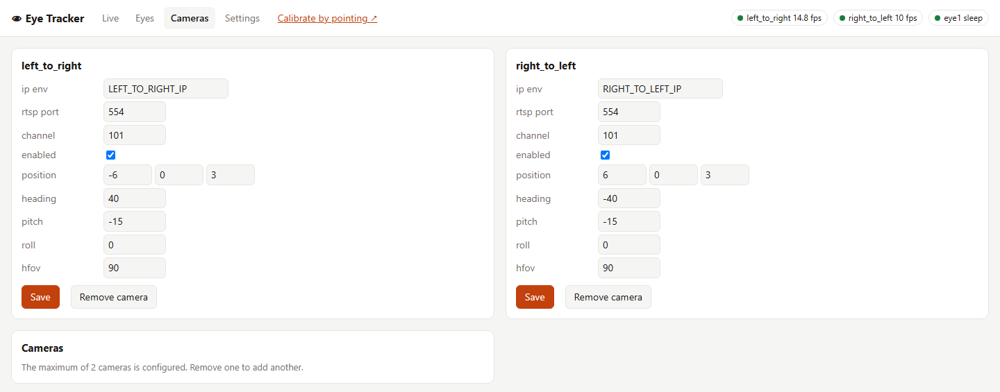
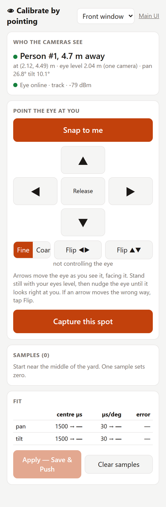

# Spooky Eye Tracker

[](https://github.com/coreyfournier/SpookyEyeTracker/actions/workflows/ci.yml)

Up to two Hikvision cameras watch the front yard. A tracker (on a PC or in Docker) detects
people with YOLO, works out where each one is standing in the yard (in metres) and how
tall they are, and streams pan/tilt targets over UDP to one or more 3D-printed animatronic
eyes, each driven by an ESP32.

```
 0-2 cameras ─RTSP─► CameraWorker (YOLO pose + ByteTrack, per camera)
                        │ box + face keypoints → ground position + eye-level height
                        ▼
                    World (fuses the cameras into "people"; triangulates faces both cameras see)
                        ▼
                    Director (picks a person per eye: closest / spread)
                        │ pan/tilt per eye, 20 Hz UDP
                        ▼
                    ESP32 eye(s) - smoothing, blink, wander, iris colour, spooky mode
```

<p align="center">
  
  
</p>
<p align="center"><i>The eye from the street, through the window glass (left), and from the side: the frame hangs
flat on the inside of the glass from one suction cup (right).</i></p>

Detection knows nothing about eyes, and eyes know nothing about cameras. To add an eye,
flash another board and add an entry under `eyes:` in the config (or the UI).

## How it works - a tour of the web UI

The tracker serves a web UI on port 8080. These screenshots are from the real system on
Halloween night, before calibration (the camera positions are still the first guesses).

### 1. Each camera finds people



Each camera's stream runs through a YOLO pose model. The **red box** is a detected person,
and the **yellow dot** is their eyes (from face keypoints, falling back to ears, shoulders,
or 1/16 of the way down the box). The faint **grid** is the ground plane drawn every 2 m
from the camera's configured pose. When the pose is right, the grid lies flat on the lawn,
and that's how you check camera calibration. The label shows the person's estimated
position in the yard and their measured eye-level height.

### 2. Everyone is placed on a yard map



The **Live** tab's top-down map shows:
- each camera (blue square and field-of-view wedge)
- the eye (orange dot) and its current gaze (orange line)
- every person the tracker knows about

People seen by both cameras are fused into a single person, and their face is
triangulated for an exact height. **This screenshot shows why calibration matters.** The
cameras are still at their guessed positions, so the same person appears as two (#1 and
#3) about 3 m apart, and the left camera reads their eye level as 2.04 m. Once the camera
poses are corrected (the camera calibration wizard, step 4 below), those collapse into one
person at the right height.
Click anywhere on the map to make the eye look at that spot.

### 3. Each eye is configured and pushed from the UI



The **Eyes** tab has one card per eye:
- **Settings:** servo centers and limits, motion smoothing, and each behavior, all
  switchable (blink, idle wander, iris colors by state, spooky mode, sleep, lids following
  the gaze).
- **Identify:** lights that eye in one pulsing colour (cyan for eye1 and magenta for eye2 by
  default; `identify_color`), centres it with the lids open and stops tracking, wandering
  and blinking, so you can see which physical eye you're configuring. Its OLED shows
  **IDENTIFY** (the Feather's LED blinks at 1 Hz). Manual control still works while it's
  on. It turns off when you toggle it off, close the page, or after 60 s without the UI.
- **Manual-control sliders:** take over the servos to find their positions.
- **Save & Push:** writes the config file and sends the settings to the ESP32 over UDP.
- **Push:** re-sends the saved settings if the eye missed them. The status chip shows
  whether the eye is online and its config is in sync.

### 4. Cameras: 0, 1 or 2



Each camera's address, stream and pose (position, heading, pitch, field of view) can be
edited live. Cameras can be added or removed, up to two, without restarting.

### 5. Calibrate an eye from your phone



Open `/calibrate` on your phone and stand in the yard (tap **Identify** first if you have
several eyes, to make sure you've picked the right one). The page shows who the cameras
see, how far away they are, and their eye-level height.

1. **Snap to me** points the eye where the tracker thinks you are.
2. Use the arrows (0.5° or 3° steps) to nudge it until it's looking right at you, then
   tap **Capture this spot**.
3. Repeat at 4-5 spots.

The tracker fits an **aim correction** for each axis (offset + scale) from those samples.
It lives only on the PC and is applied to every angle before it's sent. **Apply** takes
effect immediately, with nothing pushed to the eye. **Reset** clears it, e.g. after moving a
camera.

<br clear="right">

## Layout

| Path | What |
|------|------|
| `tracker/` | Python tracker + web UI; `config.default.yaml` is the config template; `tests/` has the unit tests |
| `tracker-data/` | Your live `config.yaml` + `calibration.json` (git-ignored, created on first run) |
| `firmware/` | PlatformIO project; one env per eye (`eye1` = HiLetgo OLED kit, `eye2` = Adafruit HUZZAH32 Feather) |
| `cad/` | `build.py` generates the printable parts into `cad/stl/` |
| `docs/WIRING.md` | Pins, power and the servo calibration procedure |
| `Dockerfile`, `docker-compose*.yml` | Container image for the tracker |
| `.github/workflows/ci.yml` | Tests, firmware compile, Docker build + push |

## Shopping list

Per eye, unless noted. Screw and pin sizes come from the hole sizes in `cad/build.py`.
Lengths are approximate, so check against your prints.

**Electronics**

| Qty | Part | Notes |
|----:|------|-------|
| 1 | [HiLetgo ESP32 OLED WiFi Kit](https://www.amazon.com/dp/B07DKD79Y9) | Classic ESP32 + 0.96" OLED. Firmware target `heltec_wifi_kit_32_v2` |
| *or* | Adafruit HUZZAH32 ESP32 Feather | Classic ESP32, no display; status on the red LED. Firmware target `featheresp32` |
| 1 | [WS2812B 7-LED RGB ring ("jewel")](https://www.amazon.com/dp/B0B2D6JDVJ) | One ring per eye; the pack has 7, enough for 7 eyes. Lights the iris |
| 4 | SG90 micro servo (9 g) | Pan, tilt, upper lid, lower lid. MG90S (metal gear) is a drop-in upgrade |
| 1 | 5 V power supply, **3 A or more** | Powers the servos + LEDs. Four servos can stall at over 2 A, so don't use the ESP32's USB 5 V |
| 1 | DC barrel jack / screw-terminal adapter | To match the supply's plug |
| 1 | 1000 µF electrolytic capacitor, 10 V+ | Across 5 V/GND near the servos |
| 1 | 330 Ω resistor | In series with the LED data line (GPIO 13) |
| — | Jumper wires / 22 AWG hookup wire | Servo leads to GPIO 26/27/32/33, shared ground. See [docs/WIRING.md](docs/WIRING.md) |
| 1 | USB-C data cable | Flashing and serial monitor |
| *opt.* | 74AHCT125 level shifter | Only if the LED colors glitch with 3.3 V data |

**Hardware**

| Qty | Part | Used for |
|----:|------|----------|
| 2 | 3 mm dowel pin, ~15 mm | Eye pitch pivots (press-fit through the eye's side bosses into the yoke) |
| 1 | 3 mm dowel pin or M3 bolt, ~20 mm | Pan pivot through the stalk and yoke hub |
| 2 | M3 × 25-30 mm screws | Stalk (16 mm thick) to the frame pedestal (self-tapping into the printed holes) |
| 2 | M3 × 12 mm screws | Eyelid pivots: through each frame upright (self-tapping) into the lid's pivot hole |
| 2 | M2 × 6 mm screws | LED jewel to the LED insert |
| 4 | ~1.5 mm steel wire pushrods (or servo linkage kit) | Servo horns to the eye/lid tabs (2.2 mm holes). Z-bend the ends |
| 4 | M4 screws | Optional: mount the frame base |

**Printing**

| Part | Filament |
|------|----------|
| `eye_front.stl` | White or translucent **regular** PLA: the whole front glows (matte PLA blocks most light) |
| `led_insert.stl` | White PLA (reflects the most light into the iris and the white of the eye) |
| Everything else | Any PLA. Matte is fine |

**Tracker (one per installation)**
- 1-2 RTSP cameras (built for Hikvision; any camera with the same RTSP URL format works).
- A PC or server to run it. An NVIDIA GPU runs detection at full camera frame rate; CPU-only works, but slower.

## 1. Configure

1. Copy `.env.example` to `.env` and fill in the camera username, password and IPs.
   (`.env` is git-ignored. If the password contains quotes, wrap it in double quotes.)
2. The live config is `tracker-data/config.yaml` (`/config/config.yaml` in Docker), copied from
   `tracker/config.default.yaml` on first run. Cameras are optional: **0, 1 or 2** (2 is the
   maximum). Each camera takes either a literal `ip` or `ip_env` (the name of a variable in
   `.env`). You can also add and remove cameras from the UI's **Cameras** tab; changes
   apply without a restart. With no cameras the eyes still idle, wander and blink, and can
   be calibrated by hand.
3. Set each eye's `ip` (shown on its OLED - reserve it in your router's DHCP).
4. **Units.** The **m | ft** switch in the header of every page (main UI, `/calibrate`,
   `/camcal`) picks metres or feet for everything the UI shows and every distance you type.
   Heights display as 5′ 9″ in feet, and height boxes accept `5'9"`, `5.75`, `69in` or `175cm`.
   The choice is saved as `ui.units` (`metric` or `imperial`), so your phone and PC agree.
   `config.yaml`, the API and the eye protocol always stay in metres.

## 2. Run the tracker

### Option A - Docker (recommended)

Images are built by CI and published to GitHub Container Registry:

| Image | Use |
|-------|-----|
| `ghcr.io/coreyfournier/spookyeyetracker:latest` | NVIDIA GPU (CUDA). Also runs on CPU if no GPU is visible |
| `ghcr.io/coreyfournier/spookyeyetracker:cpu` | CPU only, much smaller. ~3-6 fps per camera instead of 10-15 |

On **Windows (this PC)**: install Docker Desktop with the WSL2 backend (GPU passthrough
works out of the box with a current NVIDIA driver), then:

```powershell
docker login ghcr.io -u coreyfournier      # only if the package is private: use a PAT with read:packages
docker compose pull
docker compose up -d                        # GPU
# or, without a GPU:
docker compose -f docker-compose.yml -f docker-compose.cpu.yml up -d
docker compose logs -f
```

Open http://localhost:8080. On first start the container copies the default
`config.yaml` into `./tracker-data/`. Edit it there or through the UI; calibration samples
are saved next to it. To build the image locally instead of pulling it, run
`docker compose build`.

The eyes are reached over UDP from inside the container. Docker's NAT handles the replies,
so no extra ports are needed beyond 8080 for the UI.

### Option B - directly on Windows

```powershell
python -m venv .venv
.venv\Scripts\pip install torch torchvision --index-url https://download.pytorch.org/whl/cu126
.venv\Scripts\pip install -r tracker\requirements.txt
.\run_tracker.ps1                 # cameras + eyes + UI on http://localhost:8080
.\run_tracker.ps1 --no-cameras    # just UI + eyes (servo calibration)
```

### Opening the UI from a phone

Windows Firewall blocks inbound connections by default. In an **admin** PowerShell, run:

```powershell
New-NetFirewallRule -DisplayName "Eye tracker UI (TCP 8080)" -Direction Inbound -Protocol TCP -LocalPort 8080 -Action Allow -Profile Private -RemoteAddress Any
```

Then browse to `http://<PC IP>:8080` (or `/calibrate`).

## 3. Flash an eye

```powershell
cd firmware
pio run -e eye1 -t upload        # HiLetgo OLED kit
pio run -e eye2 -t upload        # Adafruit HUZZAH32 Feather
pio device monitor
```

**Over-the-air updates.** After the first USB flash, update an eye over WiFi:

```powershell
pio run -e eye1_ota -t upload    # builds eye1 and uploads it; IP comes from the running tracker
pio run -e eye2_ota -t upload --upload-port 192.168.2.144    # or give the IP yourself
```

You can also use **Update firmware…** on an eye's card in the web UI and pick
`firmware/.pio/build/<eye>/firmware.bin`. The eye holds still while the update is written,
shows `UPDATING n%` (the Feather's LED flickers), then reboots into the new firmware. Its
firmware badge in the UI turns green once it's current.

OTA is protected by `EYE_OTA_PASSWORD` in `.env`. It's baked into the firmware at build time
and used for each upload, so builds without it have no update endpoint. The eye rejects an
image built for the other board type, since the pins differ.

Each `[env:eyeN]` in `platformio.ini` is one physical eye. It builds on a board section
(`[heltec]` or `[feather]`) and sets `EYE_NAME`. To add another eye, copy an env, give it the
next name, and add a matching entry under `eyes:` in the tracker config.

WiFi credentials come from the `ENV_WIFI_SSID` / `ENV_WIFI_PW` environment variables at
build time. The serial log (and the OLED, on the HiLetgo board) shows the IP. The OLED's top line shows what the eye is doing right
now (**TRACK**, **HOLD**, **STARTLE**, **WANDER**, **IDLE**, **SLEEP** or **MANUAL**). Below that are
the IP, WiFi signal, time since the last PC packet, the current pan/tilt, and which optional
behaviors are on. The web UI shows the same activity. The eye stores its last pushed config in
flash. The UI shows *config differs* if it missed a push. **Push** re-sends the saved
config, and with `director.auto_push` the tracker re-sends it automatically.

## 4. Calibrate

**Cameras (do this first).** The camera poses in the config are a first guess. Rather than
tuning them by hand, open `/camcal` on your phone (**Calibrate cameras** in the main UI)
and let the wizard walk you through it. Have the yard to yourself.

1. Enter your height (in feet, `5'9"` works), and mark a **center spot** both cameras can see. Measuring how far
   it is from the window (out toward the street, and to the side) is optional but
   recommended: it ties the cameras to the eyes.
2. Tap **Start** and pocket the phone. It reads out where to go: the center spot, left,
   right, toward the street, toward the house, and one spot of your choice. At each one
   it waits for you to stand still, records about 2 s (beep and buzz when it's got it),
   then sends you to the next. Chips show which cameras can see you; **Skip spot** and
   **Redo last** are there if a spot is out of view or someone walks past.
3. Tap **Solve**. Knowing your eye height, the tracker works out every camera's position,
   heading, pitch, roll and field of view, plus where you stood. It shows how far apart
   the cameras placed you before and after, how far off your measured height was, and a
   map of the old and new camera poses.
4. **Apply** saves the new poses (it takes effect immediately). **Undo last calibration**
   on the start screen puts the previous ones back.

Then redo the eye aim calibration below, since it was made with the old camera poses.
To check or fine-tune by hand: each camera view on **Live** draws a 2 m ground grid, a ★
where the eye should be, and a yellow dot on each detected face, and the **Cameras** tab
edits `position`/`heading`/`pitch` directly.

Eye calibration has two layers, which change for different reasons:

| Layer | Lives on | Set with | Redo when |
|---|---|---|---|
| **Servo mechanics**: `firmware.servos` (center µs, µs/deg, limits, lid open/closed) | ESP32 (pushed once, stored in flash) | Eyes tab sliders, with the eye looking straight ahead from its own point of view | You rebuild or re-horn the eye |
| **Aim correction**: `aim` (pan/tilt offset + scale) | PC only, never pushed | Calibrate by pointing | You move a camera or the eye |

The mechanics stay on the eye so it can idle, wander, sleep and respect its limits even
when the PC is offline. The aim correction absorbs camera and eye position errors. Keeping
it on the PC means moving a camera never disturbs the eye's own settings.

**Servo mechanics (once per build).** In the Eyes tab, use the µs sliders to find each
servo's centre and the lid open/closed positions. Press the buttons to copy them into the
form, then **Save & Push**. If an arrow on the calibration page moves the eye the wrong
way, flip the sign of that axis's `us_per_deg` here.

**Aim (calibrate by pointing).** Open `/calibrate` on your phone and stand in the yard.
1. **Snap to me**, nudge the eye with the arrows until it looks right at you, then **Capture**.
2. One spot sets the offset. 4-5 spots (left, centre, right, near, far) also fit the scale.
3. **Apply** saves the correction on the PC and it takes effect immediately. Nothing is
   pushed to the eye.

**Eye-level height.** The pose model finds each person's eyes, falling back to their ears,
then shoulders, then 1/16 of the way down the box. With the feet visible, one camera
measures eye level from the ground position. When both cameras see the face, they
triangulate it. `world.look_height` is used only when height can't be measured.

## 5. Print

Generate the parts with `.venv\Scripts\python cad\build.py` (needs `trimesh` and
`manifold3d`).

<p align="center">
  
  
</p>
<p align="center"><i>From inside the house: the eye in its gimbal, the four SG90 servos (blue) and the
lattice frame (left). The frame on its own (right).</i></p>


These renders come from `.venv\Scripts\python cad\render.py`, which uses Playwright,
headless Edge and three.js. Rerun it after changing the CAD.

**How the eye lights up.** The whole front of the eye glows, in two zones:

| Zone | Shell thickness | Lit by |
|------|-----------------|--------|
| Iris (40 mm circle) | 0.8 mm | The jewel's **centre LED**, carried out to the iris by the LED insert's funnel |
| White of the eye | 1.2 mm | The **six ring LEDs**, which sit outside the funnel |

The firmware drives them separately: the iris shows the state colour (idle / tracking /
sleep) and the white shows the `sclera` colour. Paint a pupil on the iris if you want one.

**Printing tips.**
- `eye_front.stl` includes a snap-off support ring under its mating rim. Print it seam-face
  down and remove the ring afterwards. Turn on supports (build plate only, tree style) for
  the inside of the iris dome. They're reachable through the open back.
  `eye_front_nosupport.stl` is the same part without the ring, for slicer-generated supports.
- `led_insert.stl` prints back-face down with no supports (45° walls). Glue its rim to the
  inside of the iris. If the iris and the white bleed into each other, paint the funnel's
  outside dark.
- `eye_rear.stl` has snap-off blocks under its pivot bosses, and `yoke.stl` sits flat.

**Window mount.** `frame.stl` hangs the whole eye on the inside of a window. Its front
plate sits flat against the glass, with an arched opening the eye looks out through. Above
the eye is a pocket for one large threaded suction cup (UBL large threaded cup, up to
2.68" / 68 mm across, 8-32 stud):

1. Press the cup onto the glass where the eye should go.
2. Push the frame over it, so the cup sits in the pocket and its stud comes through the
   hole in the pocket floor.
3. Thread the brass nut on behind and snug it up. That pulls the frame flat against the
   glass, and the frame hangs plumb under the cup on its own.

The pocket is 14 mm deep, measured from the glass to the back of the cup's hub (`CUP_DEPTH`
in `cad/build.py`). Press one of your cups flat on a window and measure:
- **Hub sits shallower than 14 mm:** stack `cup_shims.stl` washers (1, 2 and 4 mm) on the
  stud between the hub and the pocket floor.
- **Hub sits much deeper:** set `CUP_DEPTH` and rebuild.

The whole frame (tray, servo cradles and window plate) is about 400 g of PLA. One cup is
rated for 7 lb.

To save filament and print time, every wall of the frame is a thin plate with diamond
lattice cut-outs. The plates stay solid wherever another part joins them, and diagonal ribs
carry the cup's pull down to the base corners. **Print it base-down at 100% infill (or
enough walls to fill 3-4 mm) with no supports.**
- The lattice diamonds have 60° sides, so they're self-supporting.
- The view opening and the cup pocket have 45° shoulders up to a 20 mm flat top that
  bridges.
- The cup pocket has a 45° chin underneath, so nothing starts in mid-air.

The frame is 180 × 188 × 217 mm (W × D × H), so it needs a printer with at least 220 mm of
Z height.

## Tests and CI

Run the unit tests locally (no GPU, cameras or ESP32 needed):

```powershell
.venv\Scripts\pip install -r tracker\requirements-test.txt
cd tracker
..\.venv\Scripts\python -m pytest
```

They cover the camera geometry, keypoint fallbacks, person fusion and height triangulation,
the director's assignment strategies, the calibration fit, config validation (including
the 2-camera limit), the UDP protocol against a fake eye, the camera manager and the web API.

GitHub Actions ([.github/workflows/ci.yml](.github/workflows/ci.yml)) runs on every push and PR:

1. **Unit tests** - pytest, with a JUnit report uploaded as an artifact.
2. **Firmware build** - compiles the PlatformIO project (placeholder WiFi credentials).
3. **Docker image** - built for both `cuda` and `cpu` once the other jobs pass. On `main`,
   pushes `:latest` and `:cpu` plus `:sha-<commit>` tags to `ghcr.io`. A `v1.2.3` git tag
   also publishes `:1.2.3` / `:1.2.3-cpu`. Pull requests build but don't push. The CPU
   image gets a smoke test.

The workflow uses the built-in `GITHUB_TOKEN`, so no secrets are needed. The first push
creates the package as **private**. Change its visibility under the repo's **Packages**
if you want to pull without logging in.

## Protocol (UDP, JSON, port 4210)

| PC → eye | Purpose |
|----------|---------|
| `{"t":"look","tgt":1,"pan":12.5,"tilt":-3,"new":0}` | gaze target at 20 Hz (`tgt:0` = nobody) |
| `{"t":"cfg","ver":N,...}` | config push → eye replies `{"t":"ack","ver":N}` |
| `{"t":"manual",...}` / `{"t":"release"}` | calibration override |
| `{"t":"ping"}` | → `{"t":"status","state":"track",...}` |
