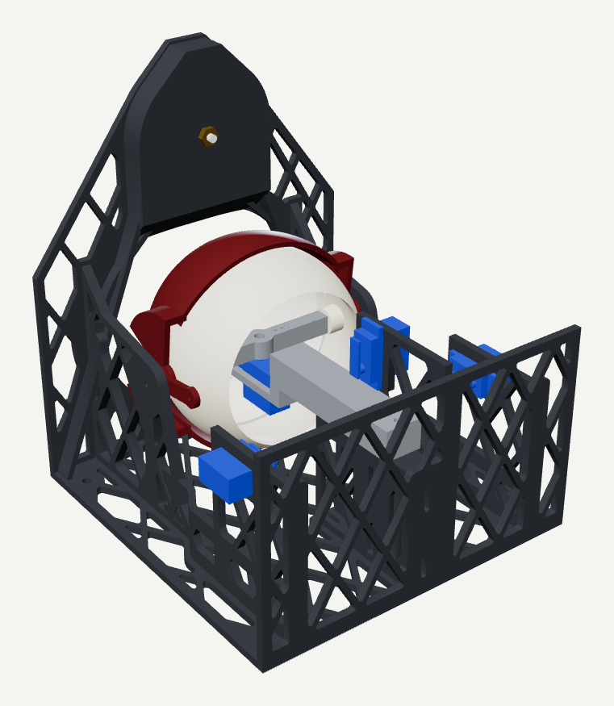
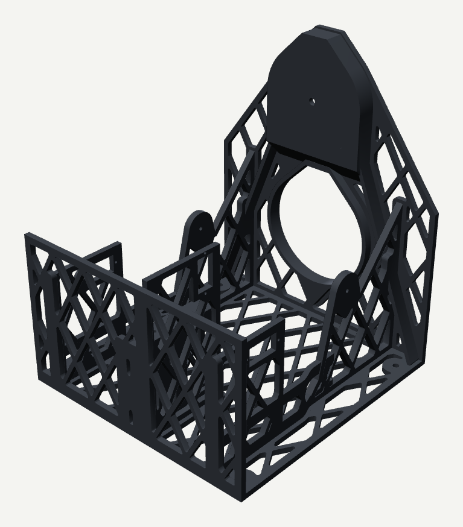
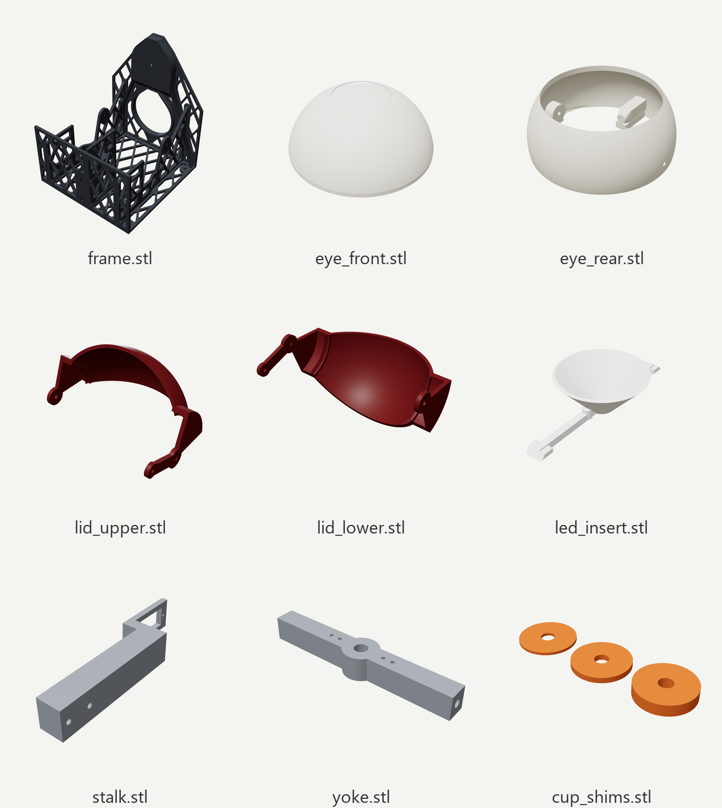

# Printed eye and window mount

The eye is a 102 mm (4 in) hollow eyeball that glows from inside. It sits in a two-axis
gimbal (pan and tilt) between an upper and a lower eyelid, all moved by SG90 servos. A
lattice frame holds everything and hangs flat on the inside of a window from one suction
cup. Every part is generated by a Python script, so dimensions can be changed and the
STLs rebuilt.

[← Back to the overview](../README.md)

<p align="center">
  
  
</p>
<p align="center"><i>From inside the house: the eye in its gimbal, the four SG90 servos (blue) and the
lattice frame (left). The frame on its own (right).</i></p>

- [The parts](#the-parts)
- [Shopping list](#shopping-list)
- [How the eye lights up](#how-the-eye-lights-up)
- [Printing](#printing)
- [Window mount](#window-mount)
- [Generating the STLs](#generating-the-stls)
- [Rendering](#rendering)

## The parts



| File | What it is |
|------|------------|
| `frame.stl` | Window plate, cup pocket, base tray, servo cradles, lid pivots and the stalk pedestal, in one piece |
| `eye_front.stl` | Front of the eyeball: the glowing white and iris. Twist-locks onto the rear (bayonet with a click detent) |
| `eye_rear.stl` | Back of the eyeball: the side pivot bosses and the tabs the pan and tilt pushrods pull on |
| `led_insert.stl` | Funnel that carries the jewel's centre LED to the iris and keeps the ring LEDs' light on the white |
| `lid_upper.stl`, `lid_lower.stl` | Eyelids, each with a lever arm for its servo pushrod |
| `yoke.stl` | Gimbal cross-piece: the eye pivots on its ends (tilt), and it turns on the stalk (pan) |
| `stalk.stl` | Arm from the frame's pedestal forward to the yoke |
| `cup_shims.stl` | Spacers (1, 2 and 4 mm) for the suction cup pocket, if needed |
| `*_nosupport.stl` | Versions of the eye halves without the built-in snap-off supports |
| `ASSEMBLY_*.stl` | Everything in place, for checking (not for printing) |

## Shopping list

Per eye. Screw and pin sizes come from the hole sizes in `cad/build.py`. Lengths are
approximate, so check against your prints. Electronics are listed in
[FIRMWARE.md](FIRMWARE.md#shopping-list).

**Hardware**

| Qty | Part | Used for |
|----:|------|----------|
| 1 | Large threaded suction cup, 8-32 stud with nut (e.g. UBL large threaded cup) | Hangs the frame on the window. Up to 2.68" / 68 mm across |
| 2 | 3 mm dowel pin, ~15 mm | Eye pitch pivots (press-fit through the eye's side bosses into the yoke) |
| 1 | 3 mm dowel pin or M3 bolt, ~20 mm | Pan pivot through the stalk and yoke hub |
| 2 | M3 × 25-30 mm screws | Stalk (16 mm thick) to the frame pedestal (self-tapping into the printed holes) |
| 2 | M3 × 12 mm screws | Eyelid pivots: through each frame upright (self-tapping) into the lid's pivot hole |
| 2 | M2 × 6 mm screws | LED jewel to the LED insert |
| 4 | ~1.5 mm steel wire pushrods (or servo linkage kit) | Servo horns to the eye/lid tabs (2.2 mm holes). Z-bend the ends |
| 4 | M4 screws | Optional: screw the frame down to a shelf instead of hanging it |

**Filament**

| Part | Filament |
|------|----------|
| `eye_front.stl` | White or translucent **regular** PLA. The whole front glows, and matte PLA blocks most light |
| `led_insert.stl` | White PLA (reflects the most light into the iris and the white of the eye) |
| Everything else | Any PLA. Matte is fine. A dark colour makes the frame disappear behind the glass |

Altogether it takes about 600 g: the frame is about 400 g, the eye parts about 170 g.

## How the eye lights up

The whole front of the eye glows, in two zones:

| Zone | Shell thickness | Lit by |
|------|-----------------|--------|
| Iris (40 mm circle) | 0.8 mm | The jewel's **centre LED**, carried out to the iris by the LED insert's funnel |
| White of the eye | 1.2 mm | The **six ring LEDs**, which sit outside the funnel |

The firmware drives them separately: the iris shows the state colour (idle / tracking /
sleep) and the white shows the `sclera` colour (see
[Firmware → behaviours](FIRMWARE.md#behaviours)). Paint a pupil on the iris if you want one.

## Printing

**Eye parts.**
- `eye_front.stl` includes a snap-off support ring under its mating rim. Print it seam-face
  down and remove the ring afterwards. Turn on supports (build plate only, tree style) for
  the inside of the iris dome; they're reachable through the open back.
  `eye_front_nosupport.stl` is the same part without the ring, for slicer-generated supports.
- `led_insert.stl` prints back-face down with no supports (45° walls). Glue its rim to the
  inside of the iris. If the iris and the white bleed into each other, paint the funnel's
  outside dark.
- `eye_rear.stl` has snap-off blocks under its pivot bosses, and `yoke.stl` sits flat.

**Frame.** To save filament and print time, every wall of the frame is a thin plate with
diamond lattice cut-outs. The plates stay solid wherever another part joins them, and
diagonal ribs carry the cup's pull down to the base corners. **Print it base-down at 100%
infill (or enough walls to fill 3-4 mm) with no supports.**
- The lattice diamonds have 60° sides, so they're self-supporting.
- The view opening and the cup pocket have 45° shoulders up to a 20 mm flat top that
  bridges.
- The cup pocket has a 45° chin underneath, so nothing starts in mid-air.
- The only other overhangs are short bridges (23 mm or less) across the tops of lattice
  holes and servo pockets.

The frame is 180 × 188 × 217 mm (W × D × H), so it needs a printer with at least 220 mm of
Z height.

## Window mount

`frame.stl` hangs the whole eye on the inside of a window. Its front plate sits flat
against the glass, with an arched opening the eye looks out through. Above the eye is a
pocket for one large threaded suction cup (up to 2.68" / 68 mm across, 8-32 stud):

1. Press the cup onto the glass where the eye should go.
2. Push the frame over it, so the cup sits in the pocket and its stud comes through the
   hole in the pocket floor.
3. Thread the nut on behind and snug it up. That pulls the frame flat against the glass,
   and the frame hangs plumb under the cup on its own.

The pocket is 14 mm deep, measured from the glass to the back of the cup's hub (`CUP_DEPTH`
in `cad/build.py`). Press one of your cups flat on a window and measure:
- **Hub sits shallower than 14 mm:** stack `cup_shims.stl` washers on the stud between the
  hub and the pocket floor.
- **Hub sits much deeper:** set `CUP_DEPTH` and rebuild.

The assembled eye weighs roughly 600-650 g with servos and electronics. One cup is rated
for 7 lb (3 kg). Because the weight hangs behind the glass, the cup carries the pull and
the bottom of the frame presses against the glass.

The eye's centre sits 60 mm behind the glass, so the eye and lids never touch it. It can
turn ±25° inside the 80 mm opening.

## Generating the STLs

```powershell
.venv\Scripts\pip install trimesh manifold3d
.venv\Scripts\python cad\build.py
```

`cad/build.py` writes every part to `cad/stl/`, in its print orientation. It then checks the
assembly and prints the result: no part may overlap another, with the lids open or closed
and with the eye turned ±20° in each direction.

Main settings at the top of each section of `build.py`:

| Setting | Default | What |
|---------|---------|------|
| `R_EYE` | 51 mm | Eyeball radius (102 mm eye) |
| `FRONT_WALL` | 1.2 mm | Thickness of the glowing white of the eye |
| `IRIS_R` | 20 mm | Iris radius |
| `LID_OPEN` | 45° | Eyelid travel |
| `JEWEL_HOLE_X` | 9.2 mm | Half the jewel's mounting-hole spacing. Measure yours |
| `Y_GLASS` | 60 mm | Glass plane, measured forward from the eye's centre |
| `VIEW_R` | 40 mm | Radius of the opening the eye looks through |
| `CUP_POCKET_R` | 35 mm | Suction cup pocket radius (fits a 68 mm cup) |
| `CUP_DEPTH` | 14 mm | Glass to the back of the cup's hub |
| `CUP_Z` | 97 mm | Suction cup height above the eye's centre |
| `RIB`, `LATTICE` | 3 mm, 24 mm | Lattice rib width and spacing |
| `BASE_T` | 4 mm | Base and rear (servo) wall thickness |

## Rendering

The pictures in these docs come from:

```powershell
.venv\Scripts\pip install playwright pillow
.venv\Scripts\python cad\render.py
```

It builds the parts, places them as assembled (with a window pane and a suction cup for
context), and renders them with three.js in headless Edge. It writes
`docs/images/cad-*.png`. It needs an internet connection to load three.js. Rerun it after
changing the CAD.
