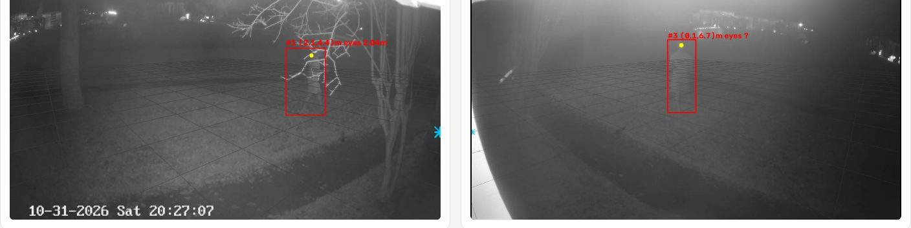
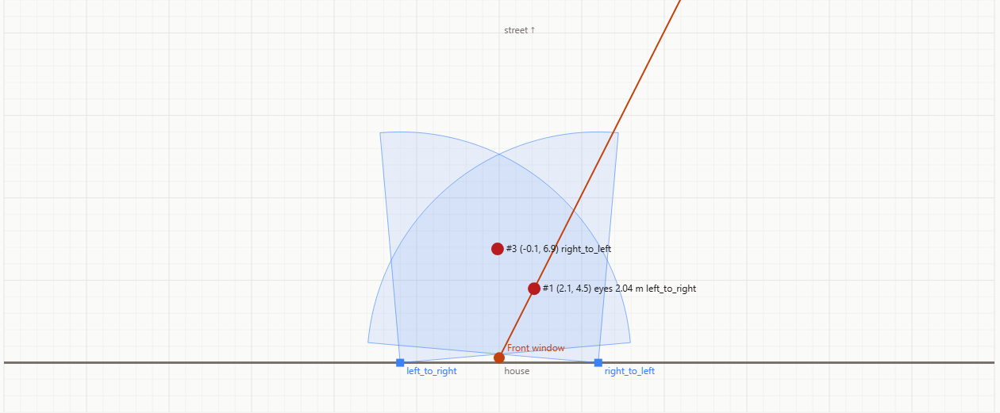
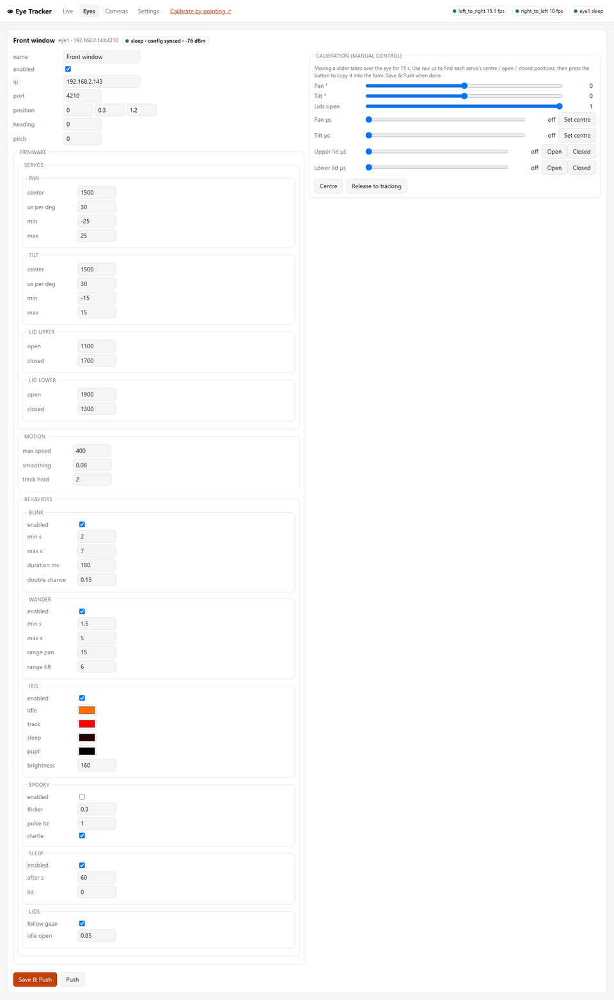
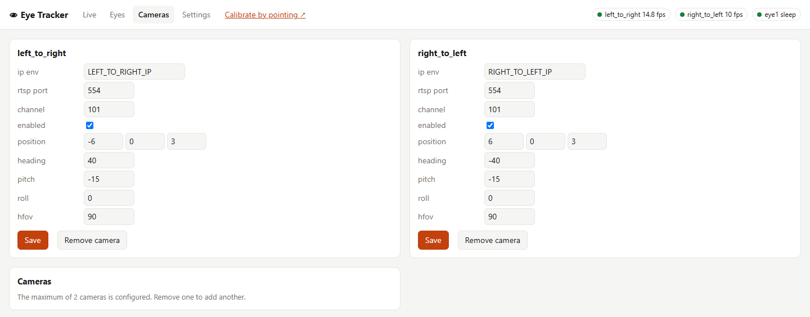
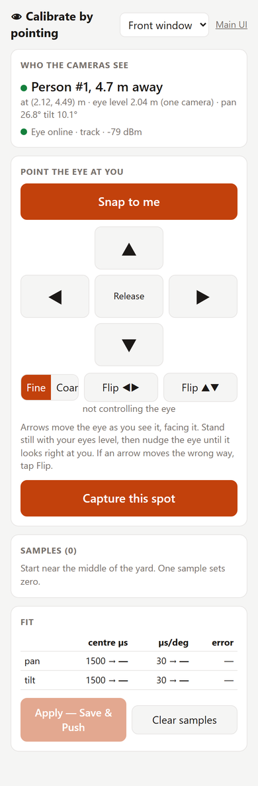

# Tracker (PC)

The tracker is the brain of the system. It reads up to two cameras, finds people, works
out where they are in the yard, decides which person each eye should watch, and streams
pan/tilt angles to the eyes 20 times a second. Everything is set up from its web UI on
port 8080, including two phone pages for calibrating while you stand in the yard.

[← Back to the overview](../README.md)

- [Requirements](#requirements)
- [Configure](#configure)
- [Run](#run)
- [The web UI](#the-web-ui)
- [Calibration](#calibration)
- [How people are located](#how-people-are-located)
- [Files and data](#files-and-data)
- [Tests and CI](#tests-and-ci)

## Requirements

- 1-2 cameras of any of these [types](#camera-types): Hikvision, any ONVIF IP camera, any RTSP
  stream, or a USB webcam plugged into the PC running the tracker.
  Cameras are optional: with none, the eyes still idle, wander and blink, and can be
  calibrated by hand.
- A PC or server. An NVIDIA GPU runs detection at full camera frame rate (10-15 fps per
  camera); CPU-only works, but slower (about 3-6 fps).
- Docker (recommended), or Python 3.13 on Windows.

## Configure

1. Copy `.env.example` to `.env` and fill in the camera username, password and IPs.
   `.env` is git-ignored. If the password contains quotes, wrap it in double quotes.
2. The live config is `tracker-data/config.yaml` (`/config/config.yaml` in Docker). It's
   copied from `tracker/config.default.yaml`, which explains every setting, on first run.
   - **Cameras:** up to 2, of any [type](#camera-types). Network cameras take either a
     literal `ip` or `ip_env` (the name of a variable in `.env`). It's easiest to add and
     remove cameras on the UI's **Cameras** tab; changes apply without a restart.
   - **Eyes:** set each eye's `ip`, which is shown on its OLED or in its serial log.
     Reserve it in your router's DHCP so it never changes.
3. Set `EYE_OTA_PASSWORD` in `.env` to any long random string. It protects over-the-air
   firmware updates (see [Firmware → OTA](FIRMWARE.md#over-the-air-updates)).

Most settings are easier to change in the UI than in the file. Every setting that isn't
obvious has an **ⓘ** button that explains what it does and what changing it will do.

### Units

The **m | ft** switch in the header of every page (main UI, `/calibrate`, `/camcal`) picks
metres or feet for everything the UI shows and every distance you type.
- Heights display as 5′ 9″ in feet.
- Height boxes accept `5'9"`, `5.75`, `69in` or `175cm`.

The choice is saved as `ui.units` (`metric` or `imperial`), so your phone and PC agree.
`config.yaml`, the API and the eye protocol always stay in metres.

## Run

### Option A - Docker (recommended)

Images are built by CI and published to GitHub Container Registry:

| Image | Use |
|-------|-----|
| `ghcr.io/coreyfournier/spookyeyetracker:latest` | NVIDIA GPU (CUDA). Also runs on CPU if no GPU is visible |
| `ghcr.io/coreyfournier/spookyeyetracker:cpu` | CPU only, much smaller. ~3-6 fps per camera instead of 10-15 |

On **Windows**, install Docker Desktop with the WSL2 backend (GPU passthrough works out of
the box with a current NVIDIA driver), then:

```powershell
docker login ghcr.io -u coreyfournier      # only if the package is private: use a PAT with read:packages
docker compose pull
docker compose up -d                        # GPU
# or, without a GPU:
docker compose -f docker-compose.yml -f docker-compose.cpu.yml up -d
docker compose logs -f
```

Open http://localhost:8080. On first start the container copies the default
`config.yaml` into `./tracker-data/`. Edit it there or through the UI; calibration data is
saved next to it. To build the image locally instead of pulling it, run
`docker compose build`.

The eyes are reached over UDP from inside the container. Docker's NAT handles the replies,
so no ports are needed beyond 8080 for the UI.

### Option B - directly on Windows

```powershell
python -m venv .venv
.venv\Scripts\pip install torch torchvision --index-url https://download.pytorch.org/whl/cu126
.venv\Scripts\pip install -r tracker\requirements.txt
.\run_tracker.ps1                 # cameras + eyes + UI on http://localhost:8080
.\run_tracker.ps1 --no-cameras    # just UI + eyes (servo calibration)
```

### Opening the UI from a phone

Windows Firewall blocks inbound connections by default. In an **admin** PowerShell, run:

```powershell
New-NetFirewallRule -DisplayName "Eye tracker UI (TCP 8080)" -Direction Inbound -Protocol TCP -LocalPort 8080 -Action Allow -Profile Private -RemoteAddress Any
```

Then browse to `http://<PC IP>:8080` (or `/calibrate`, `/camcal`).

## The web UI

These screenshots are from the real system on Halloween night, before calibration (the
camera positions are still the first guesses).

Every card's settings are grouped into sections that open one at a time. The address bar
follows you: it names the tab, card and open section (for example `#eyes/eye1/iris`), so a
refresh or a shared link lands in the same place. Number fields show their allowed range,
and Save refuses values outside it.

### Live: each camera finds people



Each camera's stream runs through a YOLO pose model.
- The **red box** is a detected person.
- The **yellow dot** is their eyes, from face keypoints (see
  [how people are located](#how-people-are-located)).
- The faint **grid** is the ground, drawn every 2 m from the camera's configured pose. When
  the pose is right, the grid lies flat on the lawn, which is how you check camera
  calibration by eye.
- The label shows the person's estimated position in the yard and their measured
  eye-level height.

### Live: everyone is placed on a yard map



The **Live** tab's top-down map shows:
- each camera (blue square and field-of-view wedge)
- the eye (orange dot) and its current gaze (orange line)
- every person the tracker knows about

People seen by both cameras are fused into a single person, and their face is
triangulated for an exact height. **This screenshot shows why calibration matters.** The
cameras are still at their guessed positions, so the same person appears as two (#1 and
#3) about 3 m apart, and the left camera reads their eye level as 2.04 m. Once the
[camera calibration wizard](#cameras-do-this-first) corrects the camera poses, those
collapse into one person at the right height.

Click anywhere on the map to make the eye look at that spot.

### Eyes: configure and push each eye



The **Eyes** tab has one card per eye:
- **Settings:** servo centres and limits, motion smoothing, and each behaviour, all
  switchable (blink, idle wander, iris colours by state, spooky mode, sleep, lids following
  the gaze). See [Firmware → behaviours](FIRMWARE.md#behaviours).
- **Status chip:** whether the eye is online and its config is in sync, plus a firmware
  badge that turns red when the eye runs an outdated build.
- **Identify:** lights that eye in one pulsing colour (cyan for eye1 and magenta for eye2
  by default; `identify_color`). It also centres the eye with the lids open and stops
  tracking, wandering and blinking, so you can see which physical eye you're configuring.
  - Its OLED shows **IDENTIFY**, and the Feather's LED blinks at 1 Hz.
  - Manual control still works while it's on.
  - It turns off when you toggle it off, close the page, or after 60 s without the UI.
- **Manual-control sliders:** take over the servos to find their positions (see
  [servo mechanics](#servo-mechanics-once-per-build)).
- **Colours & brightness** save and push as you change them, so you can tune the colours
  while watching the eye. Other sections wait for Save & Push.
- **Save & Push:** writes the config file and sends the settings to the ESP32 over UDP.
- **Push:** re-sends the saved settings if the eye missed them.
- **Update firmware…:** uploads a new `firmware.bin` over WiFi (see
  [Firmware → OTA](FIRMWARE.md#over-the-air-updates)).
- **Simulator:** a 3D model of the eye that behaves as the eye would, including the edits
  on the card you haven't saved yet. See [Eye simulator](#eye-simulator).

### Eye simulator

Open it from **Eye simulator ↗** in the header (`/sim`), or from the **Simulator** section of
an eye card. It runs a copy of the firmware's behaviour code (`static/sim/behavior.js`, a
port of `firmware/src/behavior.cpp`) on the printed parts, so you can see what an eye will
do without one plugged in.

- **Mirror the tracker:** replays what the tracker sends that eye: who it's tracking, the
  manual sliders, Identify and Release. Use it to watch tracking from your desk, or to
  try the servo sliders before the eye is built.
- **Demo: you play the person:** click or drag in the yard to stand somewhere, or press
  **Walk past**. The eye startles, tracks, holds when you leave, wanders and then falls
  asleep. **Speed** fast-forwards its clock, so you don't have to wait 60 s to see sleep.
  Drag the eyeball to aim it by hand.
- **Try settings:** turn spooky mode, blinking, wandering and the other behaviours on and
  off in the simulator only. The saved settings are never changed from here.
- **View:** turn, zoom and slide the model; hide the frame, servos, lids or the eye front
  to see the LED insert and Jewel; cut the assembly in half; switch between night and
  daylight.

The display reads:
- what the eye is doing;
- pan, tilt and how far open each lid is;
- both LED colours;
- the four servo pulses in µs.

It also says why the eye is doing it, for example "nobody for 12 s · sleeps at 60 s".

The pose comes from the servo pulses read back through the eye's calibration, so raw µs
from the manual sliders show up as the servo would move. The simulator never sends
anything to an eye.

### Cameras: 0, 1 or 2



Each camera's address, stream and pose (position, heading, pitch, roll, field of view) can
be edited live. Cameras can be added or removed, up to two, without restarting. If a camera
can't connect, the Live tab says why (for example a refused login, or ONVIF switched off).

#### Camera types

Choose the type in the **Add a camera** card; it shows the fields that type needs.

| Type | For | What you give it |
|------|-----|------------------|
| **ONVIF** | Most IP cameras: Dahua, Reolink, Amcrest, Axis, Hikvision and others | The IP and ONVIF port (usually 80). **Find cameras** looks for ONVIF cameras on your network; **Load stream profiles** lists the camera's streams with their resolution. The tracker asks the camera for the stream address each time it connects |
| **Hikvision** | Hikvision cameras, with ONVIF off | The IP and channel (101 = main stream, 102 = sub stream) |
| **Other stream** | Any camera with an RTSP address | The full URL. `{user}`, `{password}` and `{ip}` are filled in from `.env`, so the password stays out of the config |
| **USB** | A webcam plugged into the PC running the tracker | The device number (0 = first; **Find USB cameras** lists them) and the resolution to ask for |

Network cameras log in with `CAMERA_USERNAME` / `CAMERA_PASSWORD` from `.env`. A camera that
needs a different login (Hikvision usually needs a separate ONVIF user) can name its own
`.env` variables in **username env** / **password env**.

- **ONVIF on Hikvision is off by default.** Turn it on under Configuration → Network →
  Advanced Settings → Integration Protocol, and add an ONVIF user there. Until then the
  tracker reports "has no ONVIF service"; the **Hikvision** type works without it.
- **Finding cameras from Docker.** ONVIF discovery is a broadcast on the local network, and
  it doesn't leave Docker's default network. Use `network_mode: host` (Linux), or type the
  camera's IP; everything else works either way.
- **USB cameras in Docker** need the device passed into the container (Linux):
  `devices: ["/dev/video0:/dev/video0"]` under the tracker service in `docker-compose.yml`.
  Docker Desktop on Windows can't pass webcams through, so run the tracker directly on
  Windows for a USB camera.

### Settings

Tracking and detection settings: default eye height, how detections merge into people,
how the director picks targets, and the YOLO model. Each one has an **ⓘ** explanation.

## Calibration

Calibrate in this order: servos once per build, then cameras, then each eye's aim.

### Servo mechanics (once per build)

Done on the **Eyes** tab, with the servo horns off at first. See also
[Wiring → first power-up](WIRING.md#first-power-up).

1. Use the µs sliders to find each servo's centre and the lid open/closed positions.
2. Press the buttons to copy them into the form.
3. Fit the horns and pushrods at those positions, then tune `us_per_deg`. Start from about
   11 for pan (direct drive) and 27 for tilt (see [How the eye moves](PRINTED_PARTS.md#how-the-eye-moves)).
4. **Save & Push**. This is stored on the eye.

If a servo moves the wrong way (an arrow on the calibration page moves the eye the wrong
way), flip the sign of that axis's `us_per_deg`.

### Cameras (do this first)

The camera poses in the config start as a first guess. Rather than tuning them by hand,
open `/camcal` on your phone (**Calibrate cameras** in the main UI) and let the wizard walk
you through it. Have the yard to yourself.

1. Enter your height and mark a **center spot** both cameras can see. Measuring how far it
   is from the window (out toward the street, and to the side) is optional but recommended,
   because it ties the cameras to the eyes.
2. Tap **Start** and pocket the phone. It reads out where to go: the center spot, left,
   right, toward the street, toward the house, and one spot of your choice.
   - At each spot it waits for you to stand still, records about 2 s, then beeps and
     buzzes and sends you to the next one.
   - Chips show which cameras can see you.
   - **Skip spot** and **Redo last** are there if a spot is out of view or someone walks past.
3. Tap **Solve**. Knowing your eye height, the tracker works out every camera's position,
   heading, pitch, roll and field of view, plus where you stood. It shows:
   - how far apart the cameras placed you, before and after;
   - how far off your measured height was;
   - a map of the old and new camera poses.
4. **Apply** saves the new poses and takes effect immediately. **Undo last calibration**
   on the start screen puts the previous ones back.

Then redo the eye aim calibration below, since it was made with the old camera poses.

To check or fine-tune by hand:
- each camera view on **Live** draws a 2 m ground grid, a ★ where the eye should be, and
  a yellow dot on each detected face;
- the **Cameras** tab edits `position`/`heading`/`pitch` directly.

### Eye aim (calibrate by pointing)



Open `/calibrate` on your phone and stand in the yard. Tap **Identify** first if you have
several eyes, to make sure you've picked the right one. The page shows who the cameras see,
how far away they are, and their eye-level height.

1. **Snap to me** points the eye where the tracker thinks you are.
2. Use the arrows (0.5° or 3° steps) to nudge it until it's looking right at you, then
   tap **Capture this spot**.
3. Repeat at 4-5 spots (left, centre, right, near, far). One spot sets the offset; spots
   spread out also fit the scale.

The tracker fits an **aim correction** for each axis (offset + scale) from those samples.
**Apply** takes effect immediately, with nothing pushed to the eye. **Reset** clears it,
e.g. after moving a camera.

<br clear="right">

### Why two layers of eye calibration

| Layer | Lives on | Set with | Redo when |
|---|---|---|---|
| **Servo mechanics**: `firmware.servos` (centre µs, µs/deg, limits, lid open/closed) | ESP32 (pushed once, stored in flash) | Eyes tab sliders, with the eye looking straight ahead from its own point of view | You rebuild or re-horn the eye |
| **Aim correction**: `aim` (pan/tilt offset + scale) | PC only, never pushed | Calibrate by pointing | You move a camera or the eye |

The mechanics stay on the eye so it can idle, wander, sleep and respect its limits even
when the PC is offline. The aim correction absorbs camera and eye position errors. Keeping
it on the PC means moving a camera never disturbs the eye's own settings.

## How people are located

**Position.** Each camera has a pose: position, heading, pitch, roll and field of view.
The tracker draws a ray from the camera through the bottom of a person's box (their feet)
and finds where it meets the ground. People seen by both cameras are fused into one.

**Eye-level height.** The pose model finds each person's eyes, falling back to their ears,
then shoulders, then 1/16 of the way down the box.
- With the feet visible, one camera measures eye level from the ground position.
- When both cameras see the face, they triangulate it.
- `world.look_height` is used only when height can't be measured.

**Targets.** The director picks a person for each eye (`closest`, or `spread` to share
people between several eyes), converts their position into the eye's pan/tilt, applies
the eye's aim correction and sends it.

## Files and data

| Path | What |
|------|------|
| `tracker-data/config.yaml` | Live config, written by the UI's Save buttons (without the template's comments) |
| `tracker-data/calibration.json` | Eye aim samples (calibrate by pointing) |
| `tracker-data/camera_calibration.json` | Camera wizard spots, plus the previous poses for Undo |
| `.env` | Camera credentials and IPs, `EYE_OTA_PASSWORD` (git-ignored) |
| `tracker/config.default.yaml` | Commented template for every setting |
| `tracker/eyetracker/static/model/` | The assembled parts for the simulator, from `cad/export_sim.py` |

## Tests and CI

Run the unit tests locally (no GPU, cameras or ESP32 needed):

```powershell
.venv\Scripts\pip install -r tracker\requirements-test.txt
cd tracker
..\.venv\Scripts\python -m pytest
```

The tests cover:
- camera geometry, keypoint fallbacks, person fusion and height triangulation;
- the director's assignment strategies;
- eye aim fitting, and the camera calibration solver and wizard;
- config validation (including the 2-camera limit and units);
- the UDP protocol against a fake eye, OTA uploads against a fake update server;
- the camera manager and the web API.

GitHub Actions ([.github/workflows/ci.yml](../.github/workflows/ci.yml)) runs on every push
and PR:

1. **Unit tests:** pytest, with a JUnit report uploaded as an artifact.
2. **Firmware build:** compiles the PlatformIO project (with placeholder WiFi credentials).
3. **Docker image:** built for both `cuda` and `cpu` once the other jobs pass.
   - On `main`, it pushes `:latest` and `:cpu` plus `:sha-<commit>` tags to `ghcr.io`.
   - A `v1.2.3` git tag also publishes `:1.2.3` / `:1.2.3-cpu`.
   - Pull requests build but don't push.
   - The CPU image gets a smoke test.

The workflow uses the built-in `GITHUB_TOKEN`, so no secrets are needed. The first push
creates the package as **private**. Change its visibility under the repo's **Packages**
if you want to pull without logging in.
